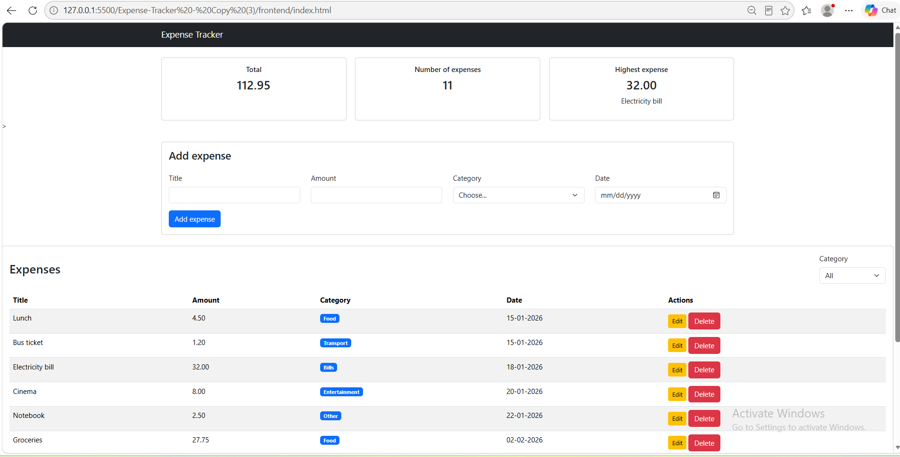
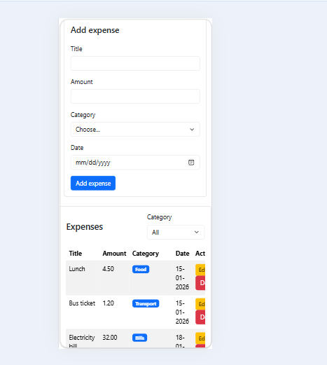

# Expense Tracker

A full-stack web application for managing personal expenses.

The project allows users to add, view, edit, delete, and filter expenses. It also displays summary information such as the total amount, number of expenses, and highest expense.

## Technologies Used

### Frontend
- HTML5
- CSS3
- JavaScript
- Bootstrap 5

### Backend
- Node.js
- Express.js
- CORS
- dotenv

### Database
- PostgreSQL
- pg (node-postgres)

## Project Structure

```text
Expense-Tracker/
├── backend/
│   ├── .env
│   ├── .gitignore
│   ├── db.js
│   ├── package.json
│   ├── package-lock.json
│   ├── server.js
│   └── test-db.js
│
├── frontend/
│   ├── index.html
│   ├── script.js
│   └── style.css
│
├── phase0/
│   ├── task1-fetch/
│   ├── task2-express/
│   └── task3-postgresql/
│
├── package.json
└── README.md
```

## Database Setup

The application uses a PostgreSQL database named:

```text
tracker_expense
```

Create the database in PostgreSQL/pgAdmin, then run the following schema inside the `tracker_expense` database:

```sql
DROP TABLE IF EXISTS expenses;

CREATE TABLE expenses (
    id SERIAL PRIMARY KEY,
    title VARCHAR(100) NOT NULL CHECK (btrim(title) <> ''),
    amount NUMERIC(10,2) NOT NULL CHECK (amount > 0),
    category VARCHAR(20) NOT NULL CHECK (
        category IN ('Food', 'Transport', 'Bills', 'Entertainment', 'Other')
    ),
    date DATE NOT NULL
);

INSERT INTO expenses (title, amount, category, date) VALUES
    ('Lunch', 4.50, 'Food', '2026-01-15'),
    ('Bus ticket', 1.20, 'Transport', '2026-01-15'),
    ('Electricity bill', 32.00, 'Bills', '2026-01-18'),
    ('Cinema', 8.00, 'Entertainment', '2026-01-20'),
    ('Notebook', 2.50, 'Other', '2026-01-22'),
    ('Groceries', 27.75, 'Food', '2026-02-02'),
    ('Taxi', 6.00, 'Transport', '2026-02-04'),
    ('Internet bill', 20.00, 'Bills', '2026-02-07');
```

### Expenses Table

| Column | Type | Description |
|---|---|---|
| `id` | `SERIAL PRIMARY KEY` | Unique expense ID |
| `title` | `VARCHAR(100)` | Expense title |
| `amount` | `NUMERIC(10,2)` | Expense amount |
| `category` | `VARCHAR(20)` | Expense category |
| `date` | `DATE` | Expense date |

Allowed categories:

- Food
- Transport
- Bills
- Entertainment
- Other

## Backend Setup

Open a terminal inside the `backend` folder and install the dependencies:

```bash
npm install
```

Create/configure the `backend/.env` file with your local PostgreSQL connection details:

```env
DB_HOST=localhost
DB_PORT=5432
DB_NAME=tracker_expense
DB_USER=postgres
DB_PASSWORD=YOUR_PASSWORD
```

Replace `YOUR_PASSWORD` with your local PostgreSQL password.

Do not share the `.env` file because it contains database credentials.

## Run the Backend

From the `backend` folder:

```bash
node server.js
```

The backend server runs on:

```text
http://localhost:3000
```

The main API endpoint is:

```text
http://localhost:3000/api/expenses
```

## Run the Frontend

Make sure the backend is running first.

Open the `frontend/index.html` file using VS Code Live Server or another local web server.

The frontend communicates with the backend API at:

```text
http://localhost:3000/api/expenses
```

## API Endpoints

### Get All Expenses

```http
GET /api/expenses
```

Returns all expenses from PostgreSQL.

**Success:** `200 OK`

### Get Expense by ID

```http
GET /api/expenses/:id
```

Example:

```http
GET /api/expenses/1
```

**Success:** `200 OK`  
**Not found:** `404 Not Found`

### Add Expense

```http
POST /api/expenses
```

Example request body:

```json
{
    "title": "Coffee",
    "amount": 3.50,
    "category": "Food",
    "date": "2026-09-24"
}
```

**Success:** `201 Created`  
**Invalid data:** `400 Bad Request`

### Update Expense

```http
PUT /api/expenses/:id
```

Example request body:

```json
{
    "title": "Dinner",
    "amount": 15.00,
    "category": "Food",
    "date": "2026-09-24"
}
```

**Success:** `200 OK`  
**Invalid data:** `400 Bad Request`  
**Not found:** `404 Not Found`

### Delete Expense

```http
DELETE /api/expenses/:id
```

**Success:** `200 OK`  
**Not found:** `404 Not Found`

## Main Features

### Summary Cards

The dashboard displays:

- Total amount of all expenses
- Number of expenses
- Highest expense and its title

### Add Expense

Users can add an expense using:

- Title
- Amount
- Category
- Date

The frontend validates the form before sending the request to the backend.

### Expenses Table

The table displays the expense title, amount, category, date, and Edit/Delete actions.

### Category Filter

Expenses can be filtered by:

- All
- Food
- Transport
- Bills
- Entertainment
- Other

### Edit Expense

The Edit button opens a Bootstrap modal with the current expense information. Saving the form sends a `PUT` request to the backend.

### Delete Expense

The Delete button sends a `DELETE` request to the backend. After deletion, the frontend requests the latest data again.

### Loading and Error Handling

The frontend uses:

- `fetch()` for API requests
- `async/await` for asynchronous operations
- `try/catch` for error handling
- A Bootstrap loading spinner while loading data
- A Bootstrap error alert when the server cannot be reached

### Responsive Design

The interface is designed for desktop and mobile screens. The summary cards use CSS Grid and change from three columns to one column on smaller screens. The expenses table uses Bootstrap's responsive table wrapper for smaller screens.

## Screenshots

### Desktop



### Mobile



## Demo Video

| Resource | Link |
|---|---|
| Short Demo Video | [Google Drive](https://drive.google.com/file/d/1MUZY4FWbwqUFcRocj-9TykiPk6HqTGTn/view?usp=drive_link) |

## Data Flow

```text
User
  ↓
Frontend (HTML/CSS/JavaScript)
  ↓
fetch()
  ↓
Express REST API
  ↓
PostgreSQL
  ↓
Express response
  ↓
Frontend updates table and summary
```

After adding, editing, or deleting an expense, the frontend calls `GET /api/expenses` again so the displayed data stays synchronized with the database.

## Phase 0 Work

The `phase0` folder contains the learning tasks completed before building the full application:

- Task 1: Fetch data from a public API and display it using Bootstrap cards.
- Task 2: Create an Express server and return JSON data.
- Task 3: Connect Express to PostgreSQL and read expense data.

## Challenges and Solutions

### PostgreSQL Connection

The backend connects to PostgreSQL using the `pg` package and environment variables from `.env`.

### CORS

The frontend and backend run on different ports during development, so CORS is enabled in Express to allow the frontend to communicate with the backend.

### Keeping the UI Updated

After add, edit, and delete operations, the frontend requests the latest data from the server again. This updates both the table and the summary cards from the current database data.

### Error Handling

The frontend checks the server response using `response.ok`. When a request fails, an error is thrown and handled by `catch`, while the user receives a clear message on the page.

## Running the Project from Scratch

1. Install PostgreSQL and make sure the PostgreSQL server is running.
2. Create a database named `tracker_expense`.
3. Run the database schema above inside `tracker_expense`.
4. Configure `backend/.env` with the local PostgreSQL credentials.
5. Open a terminal in `backend`.
6. Run `npm install`.
7. Run `node server.js`.
8. Open `frontend/index.html` with VS Code Live Server.
9. Use the application to add, edit, filter, and delete expenses.

## Submission Notes

For the final submission, do not include:

```text
node_modules/
.env
```

The `.env` file contains local database credentials and should not be submitted.

The project should include the source code and this `README.md` file.
